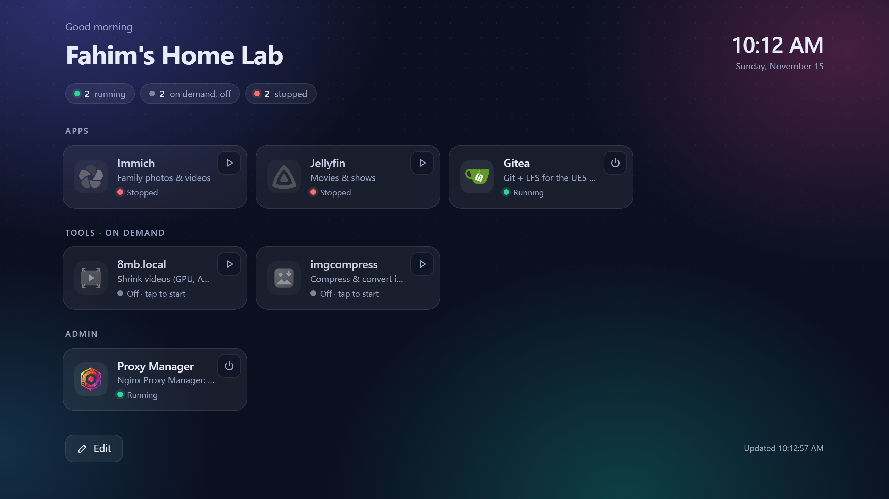
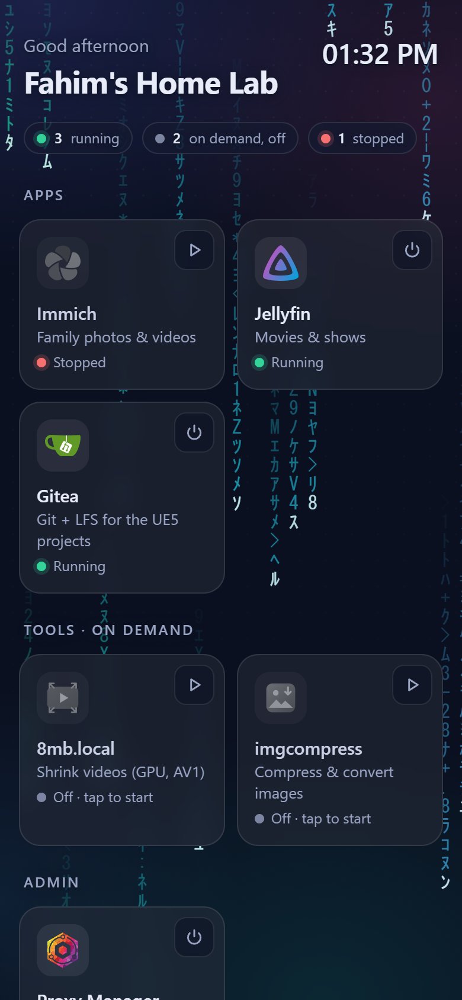
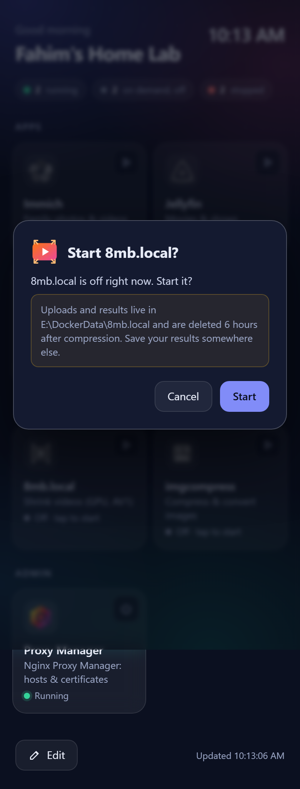
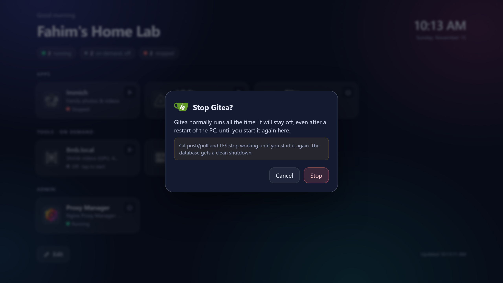
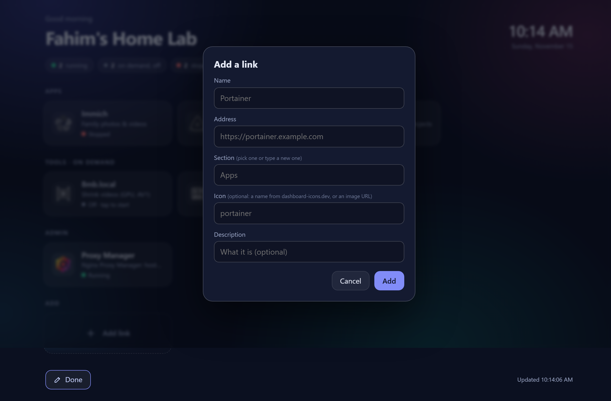
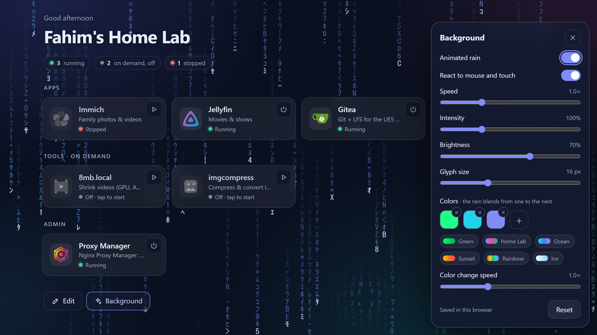

# Home Lab dashboard

One bookmark for the whole home lab: every self-hosted app on one page, with its live status
and Start/Stop buttons, on PC and phone.

It is a single tiny container (`python:3.13-alpine` running one standard-library Python file):
**about 20 MB of RAM**, no build step, no database, no JavaScript framework.



## Features
- **Live status per app.** Green *Running*, amber *Starting…*, grey *Off · tap to start* (on-demand tools), red *Stopped*.
  "Running" means the app really answers HTTP, not only that its container is up.
- **Tap to open, tap to start.** A running app opens in a new tab. A stopped one offers **Start**, waits until the app is
  ready, then shows an **Open** button.
- **Start/Stop the whole stack.** Databases start first and stop last (30 s for a clean shutdown). Apps can warn before
  starting or stopping, and 8mb.local is asked whether a job is still running before it is stopped.
- **Easy to extend.** Add a tile in `config/services.json`, or add a plain link from the page (**Edit → Add link**).
- **Phone friendly.** Two-column layout, large tap targets, "Add to Home screen" support.
- **Animated background.** Falling glyph "rain" that blends between colours you pick, with adjustable speed,
  intensity, brightness and size. A soft glow follows the mouse (or your finger) and pulses like a heartbeat; clicks
  send ripples. Can be turned off from the page. See [Background](#background).
- **Light.** Status refreshes every 10 s only while the page is visible. The animation runs only in the browser and
  pauses when the tab is hidden.

| Phone | Start an on-demand tool | Stop dialog | Add a link |
|---|---|---|---|
|  |  |  |  |

## Requirements
- Docker with Compose v2. On Windows: Docker Desktop with WSL2. **Run every command from the Linux/WSL shell, not PowerShell.**
- A reverse proxy on a shared external Docker network called `npm_network`. This setup uses Nginx Proxy Manager.
- The apps you want on the page, already created once with `docker compose up -d` in their own folders.

## Install (fresh machine, or after a reinstall)
```bash
cd /mnt/wsl/dockerdata/stacks          # wherever your stacks live
git clone https://github.com/FahimKamal/homelab-dashboard.git Dashboard
cd Dashboard

cp .env.example .env                    # then edit .env: DASHBOARD_DOMAIN=<your domain>, TZ=<Continent/City>
chmod 2775 config && chmod 664 config/services.json   # the container (group 1000) saves links here
docker network create npm_network 2>/dev/null || true
docker compose up -d
```
Check it on the host: http://localhost:8088

Then add a **proxy host** in Nginx Proxy Manager:

| Field | Value |
|---|---|
| Domain | `home.<your domain>` |
| Scheme / Forward host / Port | `http` / `dashboard` / `8080` |
| Options | Block Common Exploits |
| SSL | your wildcard certificate, Force SSL, HTTP/2 |

Bookmark `https://home.<your domain>` on every device. On a phone: browser menu → **Add to Home screen**.

> The user and group are set to `0:1000` in `compose.yaml`. Group 1000 must be the owner of `config/`
> (the first normal user on Ubuntu). If yours is different, change the `1000` there.

## Adding an app
1. Start the new stack once: `docker compose up -d` in its folder. Put it on `npm_network`.
2. Add a proxy host for it in Nginx Proxy Manager.
3. Add an entry to `config/services.json`, save, and reload the page. No restart is needed.
   On Windows you can edit the file from Explorer: `\\wsl.localhost\Ubuntu\mnt\wsl\dockerdata\stacks\Dashboard\config\services.json`.

```json
{
  "name": "Portainer",
  "group": "Admin",
  "description": "Docker web UI",
  "url": "https://portainer.{domain}",
  "icon": "portainer",
  "container": "portainer",
  "check": "http://portainer:9000/"
}
```

| Field | Meaning |
|---|---|
| `name`, `url` | Required. `{domain}` in the URL is replaced by `DASHBOARD_DOMAIN` from `.env`. |
| `group` | Section heading. Tiles appear in file order. |
| `description` | Small text under the name. |
| `icon` | A name from [dashboard-icons](https://dashboard-icons.dev) (e.g. `portainer`), a file you put in `www/icons/` (e.g. `myapp.svg`), or an image URL. Without one, the site's favicon or a coloured letter is used. |
| `container` | The `container_name`. Turns on the status dot and Start/Stop. Start and Stop act on that container's whole compose project. |
| `check` | An address *inside* `npm_network` (usually the proxy's target). The tile turns green once it answers. |
| `ondemand` | `true` = normally off: shown grey, not red, when stopped. |
| `nostop` | `true` = no Stop button for this tile. |
| `update` | `true` = Start first pulls the newest image and recreates the stack if it changed (`docker compose pull` + `up -d`). For apps that must stay current (e.g. MeTube, whose yt-dlp breaks when sites change). If the pull fails (offline), it starts the version already there; if the helper itself fails, it falls back to a plain start. |
| `warn` / `stopWarn` | Text shown in the Start / Stop dialog. |
| `busy` | `{ "url": ..., "fields": [...] }`: asked before Stop, and the job counts in those fields are added up. |

If the file has a mistake (for example a missing comma), the page shows a red banner with the line number and keeps
using the last good version.

**Quick links** (no status, no Start/Stop): click **Edit → Add link** on the page. They are saved into `services.json`
with `"custom": true`, and can be removed again in Edit mode.

## Background
The page background is a canvas animation (`www/matrix.js`, no libraries): columns of glyphs falling like rain.
Click **Background** at the bottom of the page to change it. Changes apply immediately, and the panel doesn't cover
the page, so you can watch the rain while you adjust it.



| Setting | What it does |
|---|---|
| Animated rain | On/off. When off, the old static background is shown and nothing is animated. |
| React to mouse and touch | A soft glow of glyphs follows the pointer and **pulses like a heartbeat** (~55 beats per minute: a strong "lub", a softer "dub"); each beat swells it a little and sends a faint ring outwards. Moving the pointer leaves a light trail, and a click or tap sends out a bigger ripple. |
| Speed | How fast it falls. |
| Intensity | How much rain: 20% is a light drizzle, 100% is one drop per column, 300% is a downpour. |
| Brightness, Glyph size | How strongly it shows, how big the characters are. |
| Colors | Up to 6 colours. The rain blends from one to the next in a slow wave across the screen. Click a swatch to change it, **×** to remove it, **+** to add one, or pick a preset. |
| Color change speed | How fast the colours drift. *Still* keeps them in place. |
| Reset | Back to the default settings (green, cyan, indigo). |

- The settings are saved **in the browser** (localStorage), so a phone and a PC can each have their own.
- It runs at up to 60 fps on a PC and 30 fps on phones, and stops while the tab is hidden. With the system setting
  "reduce motion" it starts switched off.
- **Resource use** (measured in Chrome at 1920×1080 on a desktop with a 32-thread CPU and an RTX 4070 Ti, mouse
  hovering): default settings ≈ ¼ of one CPU core (under 1% of the whole CPU), ≈ 5% GPU, ~15 MB GPU memory and a few
  MB of RAM; 300% intensity ≈ ½ of one core. Larger screens or display scaling cost more, roughly in proportion to the
  number of pixels. Nothing extra runs on the server: the container stays at ~20 MB of RAM.
- To get rid of it completely, remove the `matrix.js` script tag and the `<canvas>` from `www/index.html`.

## Updating
| Changed | Do |
|---|---|
| `www/` (page, icons) or `config/services.json` | Reload the page |
| `server.py`, `compose.yaml` or `.env` | `docker compose up -d --force-recreate` |

Save changes to GitHub:
```bash
git add -A && git commit -m "what changed" && git push
```

## Security
**How the dashboard protects itself**
- **Docker socket.** It is mounted, which is powerful, but `server.py` only touches containers listed in
  `services.json` (and their compose projects). It can't exec into anything, and it creates exactly one kind of
  container: for tiles with `"update": true`, Start runs a short-lived helper (`docker:<version>-cli`, pinned in
  `server.py` as `UPDATER_IMAGE`) that does `docker compose pull` + `up -d` in that app's own stack folder (read-only,
  taken from the container's compose labels, no network, all capabilities dropped) and is removed afterwards.
  Values are passed as arguments, never through a shell string.
- **No cross-site requests.** Start/Stop and link changes need a custom request header. Other websites
  can't send that from your browser, because the server never allows cross-origin requests.
- **Locked-down container.** All Linux capabilities are dropped, `no-new-privileges` is set, the root filesystem is
  read-only, and only `config/` is writable. Memory is capped at 64 MB and processes at 64.
- **No login of its own.** Keep it reachable only from your private network (here: Tailscale only, through
  Nginx Proxy Manager). The direct port is bound to `127.0.0.1`. If you ever expose it to the internet, put an
  Access List (password) on the proxy host first.
- **Safe page.** A strict Content-Security-Policy is sent, links are only allowed as `http(s)://`, and nothing user-typed
  is inserted as HTML.

**This repository is public. What may and may not be committed:**

| ✅ Fine to commit | ⛔ Never commit |
|---|---|
| The code, `www/`, icons, screenshots | `.env` (your domain, timezone); it is in `.gitignore` |
| `config/services.json` with `{domain}` in the URLs | Any password, API key or token (database passwords, Immich API key, DuckDNS token, Tailscale auth key) |
| Container names, internal ports, `check` addresses | Other stacks' `.env` / compose files that contain credentials |
| `.env.example` with placeholder values | Nginx Proxy Manager data, `letsencrypt/` certificates and keys |
| | Real IP addresses (the Tailscale IP), screenshots showing private photos or data |
| | Your personal email in commits (use the GitHub `…@users.noreply.github.com` address) |

Before pushing, a quick check: `git diff --cached` and
`git grep -nIiE "password|secret|token|api[_-]?key|100\.[0-9]+\.[0-9]+\.[0-9]+"`.

## How it works
```
browser ──https──▶ Nginx Proxy Manager ──▶ dashboard:8080 (server.py)
                                               ├─ GET  /api/services    tiles from config/services.json
                                               ├─ GET  /api/status      Docker state + HTTP "ready" probe of each app
                                               ├─ POST /api/start|stop  the listed container's compose project
                                               │                        ("update": true → helper: compose pull + up -d)
                                               └─ POST/DELETE /api/links  quick links (custom: true)
```
- `server.py`: `http.server` plus the Docker Engine API over `/var/run/docker.sock`. Status results are cached for
  2.5 s, so several open devices share one Docker query.
- `www/`: `index.html`, `style.css`, `app.js` (plain JS, no libraries), `matrix.js` (the animated background
  and its settings panel) and `icons/`.
- `config/services.json`: the tiles. It is re-read whenever it changes.

## Troubleshooting
- **Red banner "Docker is not reachable".** Docker isn't running yet, or the socket mount is missing. Check `docker logs dashboard`.
- **An app stays "Starting…".** Its `check` address doesn't answer. Test it from inside the network:
  `docker exec nginx curl -sI http://<container>:<port>/`.
- **"Not created yet".** The container has never been created. Run `docker compose up -d` once in that app's folder.
- **Saving a link fails with a permission error.** Re-run the `chmod` line from Install and check the group id in `compose.yaml`.
- **A stopped app doesn't come back after a reboot.** That's intended: a stack stopped from the dashboard stays
  stopped until you start it again.

## Credits
App icons come from [homarr-labs/dashboard-icons](https://github.com/homarr-labs/dashboard-icons). The logos are
trademarks of their respective projects. The 8mb.local, imgcompress and home icons were made for this dashboard.
